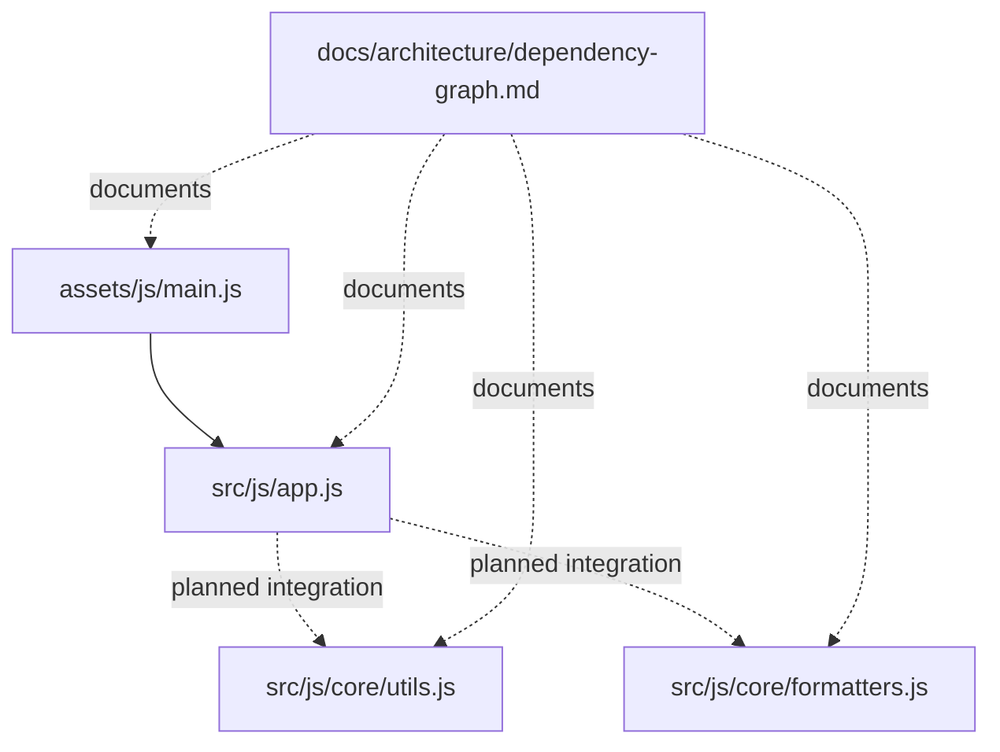
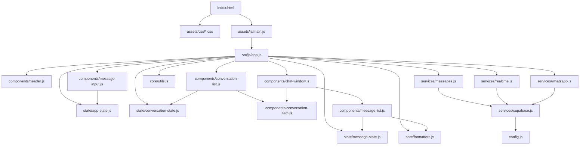

# MyWhatsApp — Dependency Graph

## Status

- Architecture: v2.0
- Gate 3: Foundation & Core
- This document describes the target architecture and the modules introduced
  in Gate 3. It does not imply that the legacy page has already been migrated.
- Current application entry remains the inline module in `index.html` until
  the integration gate is approved.

## Gate 3 foundation graph

The core modules are intentionally not imported by the application lifecycle
yet. They are standalone foundations until later gates migrate their consumers.

## Target application graph

Dashed/planned dependencies in the foundation graph are future integration
edges, not current imports.

## Module ownership

| Layer | Owns | Must not |
|---|---|---|
| Entry point | Start application lifecycle | Query data or render business UI |
| Application | Coordinate state, services, components, cleanup | Duplicate service implementations |
| State | Pure transformations and centralized state | Access DOM or Supabase |
| Components | Render UI and report user intent | Query Supabase directly |
| Core | Reusable utility and formatting functions | Depend on app state or services |
| Services | Database, Realtime, WhatsApp transport | Render DOM |
| Config | Public Supabase URL and publishable key | Contain service-role or Meta secrets |

## Compatibility and deployment

- Keep `assets/js/messages.js` and `assets/js/supabase.js` until all consumers
  have migrated and repository-wide references have been checked.
- Keep `wa/index.html` independent.
- Keep `.github/workflows/static.yml` unchanged.
- Preserve the Edge Function name `trx-send-messages` and request contract
  `{ to, message }`.
- Preserve the `trx_messages` database contract unless separately approved.
- Use relative ES module paths compatible with GitHub Pages project paths.
- Do not switch `index.html` to the new entry point until integration tests pass.

## Gate 3 module contracts

### `src/js/core/utils.js`

- `escapeHtml(value)`: escape HTML-sensitive characters.
- `getElement(id, root = document)`: resolve an element by ID; return null
  when unavailable.
- `isValidDate(value)`: validate Date-compatible input.

### `src/js/core/formatters.js`

- `formatTimeLabel(value, now = new Date())`: local Indonesian time/date label.
- `getInitials(value)`: at most two initials; `?` for empty input.
- `getMessageText(message)`: text preview or a media-type label.

### `src/js/app.js`

- `createApp()`: create or return the active lifecycle controller.
- `destroyApp()`: destroy the active controller.
- Controller exposes `registerCleanup(fn)`, `destroy()`, and `destroyed`.

## Gate 3 verification checklist

- [ ] All module imports resolve.
- [ ] Core utility edge cases pass.
- [ ] Formatters handle valid and invalid timestamps.
- [ ] Repeated `createApp()` calls do not create multiple instances.
- [ ] Cleanup runs once and continues after an individual cleanup error.
- [ ] Existing `index.html` remains the active entry.
- [ ] No existing application, service, component, workflow, or `/wa/` file changed.
